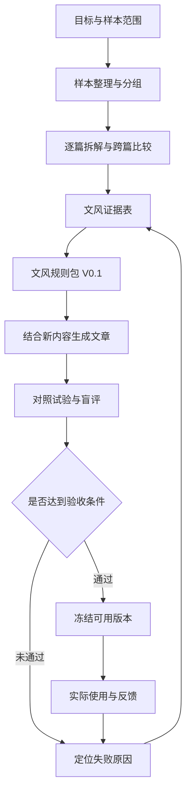

# 文风提取方法论

> 本方法论经两种差异较大的文风（公众号商业考察长文、第一人称实战分享长文）全流程验证后固化。样本数量、评分门槛和规则格式均为初始设计，按试验结果调整时，在档案的修改记录中注明。

这套体系的目标是：**从样本中提炼有证据、可执行的文风规则，用它写不同内容的新文章，并通过对照试验持续改进。**

## 一、体系范围与成功标准

长期支持不同作者、体裁和篇幅；每轮限定为**一种文风、一种体裁、一个固定模型**，先验证完整流程，再跨文风复用。

体系需要达到三个结果：

- **能解释**：每条规则都能追溯到样本，说明适用条件。
- **能迁移**：换了主题后，仍能使用这些表达方式。
- **能改善**：与直接提供范文相比，规则能够提高文风接近程度、稳定性或减少修改量。

"规则文档已经生成"只能算分析完成。新文章通过验证后，才能称为这份文风规则可用。

## 二、整体流程



整个体系围绕六类材料运转。

| 材料 | 必须包含 | 用途 |
|---|---|---|
| 样本清单 | 来源、原文、体裁、主题、日期、分组 | 管理证据与适用范围 |
| 文风证据表 | 观察、原句位置、跨篇支持、反例 | 判断哪些特征值得提炼 |
| 文风规则包 | 执行规则、适用条件、参考片段、版本 | 直接指导生成 |
| 写作任务单 | 内容材料、读者、目的、篇幅、结构要求 | 确保文章完成实际任务 |
| 试验记录 | 各组输入、模型设置、完整输出、评分 | 判断规则是否有效 |
| 修改记录 | 问题位置、原因、规则调整、复测结果 | 支持迭代与恢复旧版本 |

## 三、样本层：先明确你在学哪一种文风

每份文风档案首先写清适用范围，例如：

> 某作者近两年的中文经验分享长文，主要面向行业从业者。当前验证范围为中等篇幅文章，短广告文案与小说尚未验证。

同一作者的不同体裁、不同阶段可以分开建档，避免把不相容的表达习惯混在一起。

第一轮建议准备约 10 篇文章：

| 分组 | 建议数量 | 使用限制 |
|---|---:|---|
| 提炼样本 | 6 篇 | 用于发现规律、提炼规则和选范文 |
| 开发验证样本 | 2 篇 | 检查规则，允许据此修改 |
| 最终留出样本 | 2 篇 | 规则冻结后才使用，供最终评审参考 |

这些数量用于控制首轮工作量。样本太短、重复度高或文风差异较大时，应调整。

整理要求：

- 原文完整保存，另建带段落编号的分析文本。
- 标题、结尾、互动语等单独标记，保留分析价值。
- 同一文章及其改写版本归入同一组。
- 无法确认亲笔、经过编辑加工的情况如实标记。
- 不把点赞、阅读量直接当作文风质量标签。

## 四、拆解层：形成可核对的文风证据

采用统一的观察维度，但不要求每个维度都必须得出规则。

| 维度 | 核心问题 |
|---|---|
| 文章组织 | 怎样开头、展开、转折和结束？ |
| 论述推进 | 怎样从例子走向判断，怎样解释因果、处理反对意见？ |
| 句段节奏 | 长短句如何配合？哪里分段、停顿、加速？ |
| 词汇与句式 | 正式程度、常见表达、句式选择有什么特点？ |
| 语气与读者关系 | 怎样表达确定性、情绪、自嘲和对读者的态度？ |
| 修辞使用 | 比喻、反问、重复等在什么情况下出现，起什么作用？ |

拆解分两步进行：

1. **逐篇观察**：记录具体写法及原文位置。
2. **跨篇比较**：区分稳定特征、条件特征和偶发现象。

每条观察至少记录：

> 观察编号、特征描述、原文证据、出现条件、支持文章、反例、可信程度。

有数字就记录统计口径。例如"6 篇中有 4 篇采用这种开头"，不能将模型估计写成精确频率。统计口径优先用 `style_stats.py` 产出，不靠目测。

尤其要区分：

- 作者如何表达判断，与作者持有什么观点；
- 作者如何引入经历，与作者实际经历过什么；
- 某类文章的常规结构，与该作者独有的习惯。

## 五、规则层：把观察转换成写作动作

规则包分为三部分：

| 部分 | 内容 |
|---|---|
| 核心规则 | 在当前范围内反复成立的表达习惯 |
| 条件规则 | 在解释概念、回应质疑、讲述经历等特定情境下使用 |
| 参考片段 | 帮助理解规则的节奏和表达示例 |

第一轮优先保留少量证据充分、影响明显的规则，不为凑数量补规则。

每条规则使用以下格式：

```text
规则编号：
规则名称：
执行动作：
适用条件：
不适用情况：
原文证据：
参考示例：
检查方法：
状态：候选 / 已验证 / 停用
```

以下是格式示例，尚未对应真实作者证据：

> **规则名称**：从具体困难引入概念
> **执行动作**：解释新概念时，优先用材料中已有的具体困难引入，再解释概念如何帮助理解问题。
> **适用条件**：解释型段落，且材料包含相关场景。
> **不适用情况**：信息通知、直接答复，或材料缺少场景。
> **检查方法**：场景是否与概念相关，是否出现材料之外的虚构经历。

规则之间发生冲突时，按以下方式处理：

- 事实、来源与内容边界作为硬约束。
- 本次任务已经明确的篇幅、结构和表达要求优先落实。
- 文风规则在上述范围内发挥作用。
- 范文只作表达参考，不能引入原作者的身份、事实和立场。

"去 AI 味"的建议也必须接受目标文风检验，不能作为统一禁词表覆盖所有作者。

## 六、生成层：每次写作使用固定输入格式

每个写作任务填写一张任务单：

| 字段 | 内容 |
|---|---|
| 文章目的 | 希望读者理解什么，或完成什么行动 |
| 目标读者 | 读者背景与已有知识 |
| 内容材料 | 可使用的事实、观点、案例及来源 |
| 必须保留 | 核心判断、条件、数据和因果关系 |
| 结构要求 | 已确定的大纲，或允许自由组织的范围 |
| 形式要求 | 平台、体裁、篇幅 |
| 文风版本 | 本次使用的规则包版本 |
| 参考片段 | 按相关性选择的少量提炼样本片段 |

生成流程固定为：

**检查材料是否充足 → 确定内容结构 → 应用文风 → 检查事实与表达 → 输出。**

材料缺口需要明确指出，不能为了满足某条文风规则补出故事。

每次保留实际使用的输入、规则版本、模型与设置、输出以及修改轮次，保证后续比较有依据。

## 七、验证层：同时验证规则准确性与生成效果

先检查规则是否能解释开发验证样本，再进行生成对照。

### 7.1 开发阶段的四组对照

| 组别 | 写作输入 |
|---|---|
| A：基础组 | 内容材料＋任务要求 |
| B：范文组 | 基础输入＋参考范文 |
| C：规则组 | 基础输入＋文风规则 |
| D：组合组 | 基础输入＋文风规则＋相同参考范文 |

准备 3 个开发任务，覆盖熟悉主题、不同主题和不同篇幅。每组每个任务生成一次，共 12 篇。

各组固定内容材料、模型、篇幅要求和修改轮次。范文必须来自提炼样本；保留全部输出。

比较重点：

- C 对比 A，判断规则独立使用是否有效。
- D 对比 B，判断规则在范文之外增加了什么。
- D 对比 C，判断范文是否仍然必要。

### 7.2 盲评维度

评审时隐藏组别、打乱顺序（用 `blind_eval.py shuffle` 生成乱序盲评包，评分完成前不打开密钥），分别检查五项：

| 维度 | 评审内容 |
|---|---|
| 内容忠实 | 事实、条件、因果和观点是否保留 |
| 文风接近 | 组织方式、语气、节奏是否接近参考真文 |
| 自然可读 | 是否有生硬套用、重复和衔接问题 |
| 表达独立 | 是否搬用原文独特句子、比喻或故事 |
| 修改成本 | 需要修改哪些位置，大约耗时多少 |

文风与可读性可采用 1—5 分，并给出文本依据；事实失真单列，不允许由其他高分抵消。

### 7.3 独立复测

完成开发与调整后，冻结规则，再做一次独立复测：

- 使用 3 个全新任务。
- 将选定规则方案与预先确定的基线比较；若要证明优于直接喂范文，基线必须是 B。
- 每个任务每种方案生成两次，共 12 篇。
- 评审此时才能使用最终留出的真文。
- 如果看完结果又修改规则，这批任务转为开发材料，后续另用新任务验收。

### 7.4 初始验收门槛

首轮可以预设以下实用门槛：

- 所有候选输出都没有关键事实失真或无依据经历。
- 6 次比较中，规则方案至少 4 次在文风上获胜，平局单列。
- 任一任务不能出现规则方案连续两次落败。
- 自然可读性没有整体下降。
- 修改成本没有整体上升。

这是一组初始验收条件，只支持当前范围内的可用性判断，不代表普遍有效或统计显著。门槛核对用 `blind_eval.py tally` 解盲计分后逐条判定。

## 八、失败后如何修订

| 现象 | 优先排查 | 修订方向 |
|---|---|---|
| 规则无法解释留出真文 | 偶发特征被当成稳定规律 | 删除规则或缩小适用范围 |
| 文章符合规则，但读起来不像 | 规则只覆盖表面特征 | 补查论述推进、读者关系与情绪变化 |
| 文风接近，但内容失真 | 材料与范文发生混用 | 强化内容边界，重新验证 |
| 原主题有效，换主题失效 | 把题材词汇当作文风 | 去除主题依赖，补跨主题证据 |
| 句式反复、文章僵硬 | 软偏好被写成硬配额 | 改为条件规则，减少机械要求 |
| 加规则不如直接喂范文 | 规则冗余、冲突或遗漏 | 精简并逐组移除规则，检查效果变化 |

每轮围绕一个主要失败原因修改，保留旧版。连续两轮没有改善时，重新检查样本范围和规则设计。
