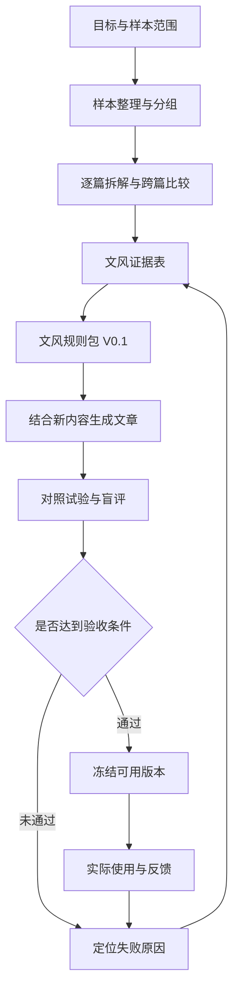

# 文风提取方法论

> 本方法论经两种差异较大的文风（公众号商业考察长文、第一人称实战分享长文）全流程验证后固化。样本数量、评分门槛和规则格式均为初始设计，按试验结果调整时，在档案的修改记录中注明。

这套体系的目标是：**从样本中提炼有证据、可执行的文风规则，用它写不同内容的新文章，并通过对照试验持续改进。**

## 一、体系范围与成功标准

长期支持不同作者、体裁和篇幅；每轮限定为**一种文风、一种体裁、一个固定模型**，先验证完整流程，再跨文风复用。

体系需要达到三个结果：

- **能解释**：每条规则都能追溯到样本，说明适用条件。
- **能迁移**：换了主题后，仍能使用这些表达方式。
- **能改善**：与直接提供范文相比，规则能够提高文风接近程度、稳定性或减少修改量。

"规则文档已经生成"只能算分析完成。新文章通过验证后，才能称为这份文风规则可用。

## 二、整体流程



整个体系围绕六类材料运转。

| 材料 | 必须包含 | 用途 |
|---|---|---|
| 样本清单 | 来源、原文、体裁、主题、日期、分组 | 管理证据与适用范围 |
| 文风证据表 | 观察、原句位置、跨篇支持、反例 | 判断哪些特征值得提炼 |
| 文风规则包 | 执行规则、适用条件、参考片段、版本 | 直接指导生成 |
| 写作任务单 | 内容材料、读者、目的、篇幅、结构要求 | 确保文章完成实际任务 |
| 试验记录 | 各组输入、模型设置、完整输出、评分 | 判断规则是否有效 |
| 修改记录 | 问题位置、原因、规则调整、复测结果 | 支持迭代与恢复旧版本 |

## 三、样本层：先明确你在学哪一种文风

每份文风档案首先写清适用范围，例如：

> 某作者近两年的中文经验分享长文，主要面向行业从业者。当前验证范围为中等篇幅文章，短广告文案与小说尚未验证。

同一作者的不同体裁、不同阶段可以分开建档，避免把不相容的表达习惯混在一起。

第一轮建议准备约 10 篇文章：

| 分组 | 建议数量 | 使用限制 |
|---|---:|---|
| 提炼样本 | 6 篇 | 用于发现规律、提炼规则和选范文 |
| 开发验证样本 | 2 篇 | 检查规则，允许据此修改 |
| 最终留出样本 | 2 篇 | 规则冻结后才使用，供最终评审参考 |

这些数量用于控制首轮工作量。样本太短、重复度高或文风差异较大时，应调整。以上数量是完整验证路线的建议，不是所有路线的准入门槛；少样本候选试用路线不要求先凑齐这些篇数，见第九节。

整理要求：

- 原文完整保存，另建带段落编号的分析文本。
- 标题、结尾、互动语等单独标记，保留分析价值。
- 同一文章及其改写版本归入同一组。
- 无法确认亲笔、经过编辑加工的情况如实标记。
- 不把点赞、阅读量直接当作文风质量标签。

## 四、拆解层：形成可核对的文风证据

采用统一的观察维度，但不要求每个维度都必须得出规则。

| 维度 | 核心问题 |
|---|---|
| 文章组织 | 怎样开头、展开、转折和结束？ |
| 论述推进 | 怎样从例子走向判断，怎样解释因果、处理反对意见？ |
| 句段节奏 | 长短句如何配合？哪里分段、停顿、加速？ |
| 词汇与句式 | 正式程度、常见表达、句式选择有什么特点？ |
| 语气与读者关系 | 怎样表达确定性、情绪、自嘲和对读者的态度？ |
| 修辞使用 | 比喻、反问、重复等在什么情况下出现，起什么作用？ |

拆解分两步进行：

1. **逐篇观察**：记录具体写法及原文位置。
2. **跨篇比较**：区分稳定特征、条件特征和偶发现象。

每条观察至少记录：

> 观察编号、特征描述、原文证据、出现条件、支持文章、反例、可信程度。

有数字就记录统计口径。例如"6 篇中有 4 篇采用这种开头"，不能将模型估计写成精确频率。统计口径优先用 `style_stats.py` 产出，不靠目测。

尤其要区分：

- 作者如何表达判断，与作者持有什么观点；
- 作者如何引入经历，与作者实际经历过什么；
- 某类文章的常规结构，与该作者独有的习惯。

## 五、规则层：把观察转换成写作动作

规则包分为三部分：

| 部分 | 内容 |
|---|---|
| 核心规则 | 在当前范围内反复成立的表达习惯 |
| 条件规则 | 在解释概念、回应质疑、讲述经历等特定情境下使用 |
| 参考片段 | 帮助理解规则的节奏和表达示例 |

第一轮优先保留少量证据充分、影响明显的规则，不为凑数量补规则。

每条规则使用以下格式：

```text
规则编号：
规则名称：
执行动作：
适用条件：
不适用情况：
原文证据：
参考示例：
检查方法：
状态：候选 / 已验证 / 停用
```

以下是格式示例，尚未对应真实作者证据：

> **规则名称**：从具体困难引入概念
> **执行动作**：解释新概念时，优先用材料中已有的具体困难引入，再解释概念如何帮助理解问题。
> **适用条件**：解释型段落，且材料包含相关场景。
> **不适用情况**：信息通知、直接答复，或材料缺少场景。
> **检查方法**：场景是否与概念相关，是否出现材料之外的虚构经历。

规则之间发生冲突时，按以下方式处理：

- 事实、来源与内容边界作为硬约束。
- 本次任务已经明确的篇幅、结构和表达要求优先落实。
- 文风规则在上述范围内发挥作用。
- 范文只作表达参考，不能引入原作者的身份、事实和立场。

"去 AI 味"的建议也必须接受目标文风检验，不能作为统一禁词表覆盖所有作者。

## 六、生成层：每次写作使用固定输入格式

每个写作任务填写一张任务单：

| 字段 | 内容 |
|---|---|
| 文章目的 | 希望读者理解什么，或完成什么行动 |
| 目标读者 | 读者背景与已有知识 |
| 内容材料 | 可使用的事实、观点、案例及来源 |
| 必须保留 | 核心判断、条件、数据和因果关系 |
| 结构要求 | 已确定的大纲，或允许自由组织的范围 |
| 形式要求 | 平台、体裁、篇幅 |
| 文风版本 | 本次使用的规则包版本 |
| 参考片段 | 按相关性选择的少量提炼样本片段 |

生成流程固定为：

**检查材料是否充足 → 确定内容结构 → 应用文风 → 检查事实与表达 → 输出。**

材料缺口需要明确指出，不能为了满足某条文风规则补出故事。

每次保留实际使用的输入、规则版本、模型与设置、输出以及修改轮次，保证后续比较有依据。

## 七、验证层：同时验证规则准确性与生成效果

先检查规则是否能解释开发验证样本，再进行生成对照。

### 7.1 开发阶段的四组对照

| 组别 | 写作输入 |
|---|---|
| A：基础组 | 内容材料＋任务要求 |
| B：范文组 | 基础输入＋参考范文 |
| C：规则组 | 基础输入＋文风规则 |
| D：组合组 | 基础输入＋文风规则＋相同参考范文 |

准备 3 个开发任务，覆盖熟悉主题、不同主题和不同篇幅。每组每个任务生成一次，共 12 篇。

各组固定内容材料、模型、篇幅要求和修改轮次。范文必须来自提炼样本；保留全部输出。

比较重点：

- C 对比 A，判断规则独立使用是否有效。
- D 对比 B，判断规则在范文之外增加了什么。
- D 对比 C，判断范文是否仍然必要。

### 7.2 盲评维度

评审时隐藏组别、打乱顺序（用 `blind_eval.py shuffle` 生成乱序盲评包，评分完成前不打开密钥），分别检查五项：

| 维度 | 评审内容 |
|---|---|
| 内容忠实 | 事实、条件、因果和观点是否保留 |
| 文风接近 | 组织方式、语气、节奏是否接近参考真文 |
| 自然可读 | 是否有生硬套用、重复和衔接问题 |
| 表达独立 | 是否搬用原文独特句子、比喻或故事 |
| 修改成本 | 需要修改哪些位置，大约耗时多少 |

文风与可读性可采用 1—5 分，并给出文本依据；事实失真单列，不允许由其他高分抵消。

### 7.3 独立复测

完成开发与调整后，冻结规则，再做一次独立复测：

- 使用 3 个全新任务。
- 将选定规则方案与预先确定的基线比较；若要证明优于直接喂范文，基线必须是 B。
- 每个任务每种方案生成两次，共 12 篇。
- 评审此时才能使用最终留出的真文。
- 如果看完结果又修改规则，这批任务转为开发材料，后续另用新任务验收。

### 7.4 初始验收门槛

首轮可以预设以下实用门槛：

- 所有候选输出都没有关键事实失真或无依据经历。
- 6 次比较中，规则方案至少 4 次在文风上获胜，平局单列。
- 任一任务不能出现规则方案连续两次落败。
- 自然可读性没有整体下降。
- 修改成本没有整体上升。

这是一组初始验收条件，只支持当前范围内的可用性判断，不代表普遍有效或统计显著。门槛核对用 `blind_eval.py tally` 解盲计分后逐条判定。

## 八、失败后如何修订

| 现象 | 优先排查 | 修订方向 |
|---|---|---|
| 规则无法解释留出真文 | 偶发特征被当成稳定规律 | 删除规则或缩小适用范围 |
| 文章符合规则，但读起来不像 | 规则只覆盖表面特征 | 补查论述推进、读者关系与情绪变化 |
| 文风接近，但内容失真 | 材料与范文发生混用 | 强化内容边界，重新验证 |
| 原主题有效，换主题失效 | 把题材词汇当作文风 | 去除主题依赖，补跨主题证据 |
| 句式反复、文章僵硬 | 软偏好被写成硬配额 | 改为条件规则，减少机械要求 |
| 加规则不如直接喂范文 | 规则冗余、冲突或遗漏 | 精简并逐组移除规则，检查效果变化 |

每轮围绕一个主要失败原因修改，保留旧版。连续两轮没有改善时，重新检查样本范围和规则设计。

## 九、少样本候选路线与配套文风包（0.2.0 新增，0.4.0 补单篇）

### 9.1 两条路线的适用与状态

| 路线 | 适用情况 | 产出与状态 | 不能宣称 |
|---|---|---|---|
| 单篇候选试用 | 只有 1 篇文章，先要一个可试写的包 | 单篇候选配套包（`sample_count: 1`）；经真实试写后记录本次可用范围 | 作者整体风格、跨题材泛化、频率推断、完整验证 |
| 少样本候选试用 | 用户素材较少（2-3 篇起），希望先获得配套文风包并试写 | 有证据与适用边界的候选配套包；经真实试写后记录本次可用范围 | 完成同等级验证、最低样本量已确定、全部体裁适用、短转长已实现 |
| 完整验证 | 用户要求系统对照、留出复测或正式晋升 | 沿用第三至八节流程；可采用新包结构作为生成载体 | 未跑对照与门槛即晋升、候选反馈可代填验证结果 |

- 候选路线不要求先凑齐“6 提炼＋2 开发验证＋2 留出”。完整路线的样本建议、四组对照、盲评与五项门槛全部保留，两条路线不互相代填。
- 候选路线只在会影响目标选择的样本分组、每篇转写方向等必要位置确认，不机械套用完整路线的逐阶段闸门；已有授权与选择直接沿用。
- 第三轮 V0.3 的满意度是开发反馈，不能代填 V0.4 的真实试写结果，也不自动改变正式基线的状态。
- 状态区分见 `archive-protocol.md` 的候选配套包约定：文件存在不能推断为用户确认或试写通过。

### 9.1.1 样本量分层与单篇样本

| 样本量 | 路线 | 能做什么 | 不能声称 |
|---|---|---|---|
| 1 篇 | 单篇候选 | 从这一篇提炼可观察动作，生成配套包，并在同类型新材料上真实试写 | 作者整体风格、跨题材泛化、频率统计、完整验证 |
| 2-3 篇 | 少样本候选 | 比较重复出现的动作，区分核心与条件规则，生成配套包 | 稳定作者特征、最低样本量已确定 |
| 8-10 篇（6 提炼＋2 开发＋2 留出） | 完整验证 | 规则包＋四组对照＋盲评＋留出复测＋五项门槛 | 全部体裁适用 |

**单篇也能走，但只能走候选路线。** 1 篇时按以下顺序执行：

1. **生成分析文本**：`P01` 为标题行，正文逐段编号；图片文字未读取时如实注明。
2. **提炼可执行动作**：每条动作引用本篇的 `S01-Pxx`，标明核心／条件／可选；只写这一篇里能观察到的动作，不补同作者其他文章。
3. **反推准备要求**：按本篇动作逐条反推需要什么材料、怎样选取、缺少时如何处理；不先写通用准备流程。
4. **生成单篇候选包**：`sample_count` 为 1、`sample_ids` 为 `["S01"]`；`source_boundary` 写清“单篇、来源、是否核验、不能声称作者稳定风格”。
5. **真实试写**：用一份同类型的新材料跑一次完整转写，记录本次可用范围、暴露的问题和未验证场景；用户评价后才谈“候选可用”。

单篇候选的强制边界：

- 不做频率、占比、稳定性推断；“在这篇里出现”不等于“作者常用”。
- 单篇里的偶然写法不得升级为普遍规则；优先核心动作＋条件规则。
- 适用场景限定为与本篇同类型的新材料；跨题材、跨体裁、跨平台均未验证。
- 不能因为只有一篇就降低证据、身份、版权或公开边界要求。
- 单篇候选不能升级为正式基线；要晋升，先补样本走完整验证路线。

### 9.2 从证据生成配套包的五步

五步按顺序执行：**先从证据形成转写动作（第 3 步），再逐条反推准备要求（第 4 步）**。不得先写一套通用准备流程再让所有文风服从该流程，也不为满足模板而倒改文风观察。

1. **登记样本来源与状态**：记录 `S{nn}`、来源、日期、是否亲笔或经过编辑加工、是否重复或改写、当前分组。候选路线也要写清哪些是观察、哪些尚无法判断。
2. **生成带段落编号的分析文本，区分文风证据与题材事实**：`P01` 约定为标题行，小节标题与列表行各占一个编号。人物、产品、数字、案例结论等题材事实只作内容边界，不写成作者表达特征。
3. **提炼转写动作并注明核心／条件／可选**：每条动作写成可执行的一句话，标注依据类型（`范文观察`／`通用执行方法`／`用户反馈适配`）与适用条件。不能把通用写作方法或本次用户喜好包装成作者稳定特征。
4. **逐条反推所需材料与准备动作，构成映射**：按“范文特征 → 转写动作 → 所需材料 → 准备动作 → 成稿检查”建立整条链。纯表达规则可注明无需新增事实材料；缺少关键材料时写明处理办法，不能补造。
5. **生成入口、共享规范、准备与转写文件并完成检查**：结构与字段遵循 `paired-package-spec.md`；`package_check.py` 检查包结构与字段，`evidence_check.py` 回查证据定位。两项都实际运行后才能记录“检查已执行”，但都不证明文风效果或用户满意。

固定候选包后再交给试写聊天；真实反馈回到对应规则或准备要求修订，修订另记包版本，不因每写一篇就改变下一篇使用的文风。

### 9.3 样本数量、总字数、结构覆盖与可辨识性

分别说明，不合并成一个“够不够”的判断：

- **样本数量**：写清篇数、独立篇数与分组。重复文章、同一文章的改写版本不算独立样本。1 篇也可作为单篇候选，但必须在 `source_boundary` 与运行记录中标明单篇，不得推断作者常用频率。
- **总字数**：标题、正文、图片文字分别计量；图片文字未读取时如实注明未纳入，不用估算冒充全文。
- **结构覆盖**：列出实际出现的开头、推进、案例／证据、收束等方式与缺失项。“没观察到”只表示当前样本未见，不升级为永久禁令。
- **可辨识性**：说明本组样本内部是否一致、与同作者其他体裁或其他作者是否容易区分；证据不足时写“尚无法判断”。

不设未经测试的最低字数门槛。样本结构或语气明显不同时，先给出候选分组与代表性写法，由用户选择本次提取对象；不擅自混成一个风格。已选分组（如 A、B）保持独立，不互相借材料。素材超出模型可读范围时逐篇处理并落证据，不以静默截断冒充全文分析。

### 9.4 证据引用与旧档案对应

旧证据使用 `note.md` 行号时，新分析文本改用 `S{nn}-P{nn}` 前必须建立真实对应：逐条打开原文或分析文本核对段落内容，再登记新引用。不得用查找替换把旧行号机械改成段落号。

`S{nn}-P{nn}` 的生成与回查规则见 `archive-protocol.md`；`evidence_check.py` 查不到的引用即删除或降级。候选路线只使用本次选中的样本，不读取其他档案的留出材料。

### 9.5 配套包的运行骨架

- **一个入口**：`{style-id}/SKILL.md`。准备阶段读 `style-contract.json` 与 `preparation.md`；成稿阶段读 `rewriting.md`。规则编号只在共享规范维护一次，准备与转写文件不复制规则表。
- **方向沟通（轻量）**：用户已有明确立意时直接沿用，不重复索取同一确认；只有材料、没有立意时，主动给出简短的核心问题与预期判断，等用户确认或修正。不要求用户批准逐段提纲、填写完整事实表或逐项确认选材。
- **确认闸门**：方向确认前不得进入正式成稿；未回复时保持待确认，不把沉默或经过一段时间当成批准。已有对等明确授权（如“按这个方向直接写”）时记录依据后继续，不重复设置大纲审批。
- **自主选材与内容容量**：方向确认后自行决定内容去留——保留多少观点、选哪些证据与案例、舍弃哪些支线，结合本套文风、目标篇幅、论证负担和必要条件判断；相近观点合并，独立支线舍弃，不把全文均匀压缩成要点清单，也不把整套框架改名成一个观点。取舍落成简短选材卡：核心判断、入选观点及关系、主要支持材料、舍弃项、必要条件——几句话或短列表即可，不要求每篇填满表格。
- **完整材料仍可读取**：转写输入包含选材卡、完整原文、任务证据、目标与配套规则；选材卡约束内容去留，不是唯一材料，转写需要原文条件、上下文或核验状态时直接回到完整原文取用。
- **表达自由**：准备只约束内容去留，不预写开场、逐段功能、句式或半成稿；正文按转写规则现场组织，不把事实检查、选材过程写成内容。
- **转写**：按本套规则组织表达，完成内容与条件、立意、文风特征、可读性四项检查；不重新选择已确认立意；材料不足、必要条件缺失或篇幅冲突时回到准备或用户，不虚构补齐。
- **证据强度与条件语义**：记忆、举例、事实、判断分别处理，来源强度不互相冒充；条件中的“或”“可能”等含义照原样保留，不压成确定表述；脱敏只移除属性，不引入新属性。
- **冲突处理与结果登记**：材料与文风要求冲突时说明具体缺口及其对文风的影响，提供补材料、收窄或换写法的选项；实际调整经用户确认并留痕，结果按四态登记——默认规则直接满足／补充材料后满足／用户确认调整后的改编／仍不适配。改变规则后的结果不称为原规则通过，用户未授权时不自动降低核心要求。
- **记录**：每篇的立意、选材卡与正文只留在本次运行记录，不写回包；模型拟定的方案不能登记为“用户已确认”，自查通过不能登记为“用户满意”。

### 9.6 与完整验证路线的关系

第三至八节的完整验证流程、样本建议、四组对照、盲评与门槛全部保留，不因新增候选路线而缩短。新包结构可作为完整验证路线的生成载体：同一套 `SKILL.md`＋`style-contract.json`＋`preparation.md`＋`rewriting.md` 可以进入对照与留出复测，验证状态仍按阶段与门槛记录。

旧规则包（档案中的规则包、已验证执行器）继续按原结构维护和使用，不因新增配套包而自动降级或强制迁移。第三轮 V0.3 只能作为开发观察和修订依据；新包必须实际读取原始样本重新产出，不能只移动旧 Skill 内容或重命名文件。

候选路线验证的是“少样本可生成配套包，并在一个新材料任务上运行”的工程链路，不替代完整验证，也不证明作者整体文风稳定或最低样本量已确定。单篇候选只验证这一篇样本上的同一链路。
